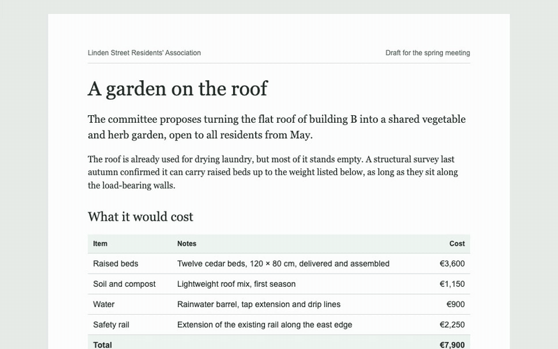

# inplace

**Write with your coding agent without breaking your flow.**



Coding agents have become good at writing documents as hand-crafted HTML: reports, proposals, handouts, meeting packets, with real typography, tables, charts and print layouts. Working on them together is still awkward. To change a word, you either edit raw markup or describe the change to the agent and wait. And as soon as you open the page in a rich-text editor, it rewrites the HTML into its own format and the layout falls apart.

inplace takes a different approach. It serves your HTML file exactly as it is and lets you click into the rendered page and type. Your change goes into that one paragraph, cell or heading, and the rest of the file stays exactly as it was. Your agent sees each edit as you make it, so when you change an amount it can fix the total. For anything bigger, such as rewording a section, adding a row or fixing a chart, you leave a comment on the page with the browser's comment tool in Claude or Codex, and the agent edits the file. Every open page reloads as soon as the file changes and briefly highlights what the agent changed, so you always see the current version and where it differs.

```bash
npx github:jonasjancarik/inplace report.html
```

## Why it works this way

- **Your edits are surgical.** Typing changes the text inside one paragraph, heading, list item or table cell, and nothing else. CSS, SVG charts, print styles and the rest of the markup stay byte-for-byte as they were, so `git diff` shows exactly what you changed.
- **The agent sees what you changed.** inplace prints a line for every edit you make on the page, so an agent running it in the background can catch, say, a changed amount and fix the total that depends on it.
- **You and the agent can work at the same time.** Edits to different blocks never get in each other's way, and edits to different words of the same paragraph are combined. If you both change the same words, the document keeps the agent's version and yours is set aside on the page, where you can compare the two and pick one. The agent is told too, so it can combine them for you.
- **The HTML file is the document.** There's no separate editor format, database or export step. What you see in the browser is the file on disk, and what you print or send is that same file.
- **Comments point at the right place.** inplace gives every block a stable `data-id`. When you comment on an element, the agent receives that id and finds the exact spot in the file, even if the wording has changed since.

## Getting started

You need Node.js 22 or newer. Install the agent skill with the [skills CLI](https://skills.sh):

```bash
npx skills add jonasjancarik/inplace
```

Then tell your agent, such as Claude Code or Codex, that you want to work on a document together in inplace, for example: "Let's work on report.html together in inplace." The agent starts inplace and opens the page in its built-in browser. Click into any paragraph, heading, list item or table cell to type, and comment on an element with the browser's comment tool when you want the agent to change something.

To try it without a document of your own, give your agent this prompt:

```text
Download https://raw.githubusercontent.com/jonasjancarik/inplace/main/examples/garden-proposal.html into this folder, open it in inplace, and walk me through how we can work on it together. Check the inplace skill for what I can do on the page.
```

The skill tells the agent how to run inplace, find a commented element by its `data-id`, keep the ids intact, and check totals and charts after you change a number.

### Running it yourself

You can also start inplace without an agent and open `http://localhost:8765/` in any browser:

```bash
npx github:jonasjancarik/inplace path/to/document.html
```

The first run takes a little longer while npm downloads and builds it. inplace writes to the file it serves, so to try it on the example, copy it first:

```bash
cp examples/garden-proposal.html /tmp/ && npx github:jonasjancarik/inplace /tmp/garden-proposal.html
```

## What you can and can't edit on the page

You can change the text of any paragraph, heading, list item, table cell, caption or text box. Enter leaves the block (Shift+Enter adds a line break), and pasted text arrives as plain text so it doesn't bring stray formatting along.

**Formatting.** Select some text and a small toolbar appears with bold, italic, strikethrough, code and link. The same works from the keyboard:

| | Shortcut | Or type |
| --- | --- | --- |
| Bold | ⌘B / Ctrl+B | `**bold**` |
| Italic | ⌘I / Ctrl+I | `*italic*` or `_italic_` |
| Strikethrough | ⌘⇧X / Ctrl+Shift+X | `~~struck~~` |
| Code | ⌘E / Ctrl+E | `` `code` `` |
| Link | ⌘K / Ctrl+K | |

The toolbar also turns a paragraph into a heading (H1–H3) or back. Typing `#`, `##` or `###` and a space at the start of a paragraph does the same. The formatting is written as plain HTML (`<strong>`, `<em>`, `<s>`, `<code>`, `<a>`), so the document's own styles decide how it looks.

**Adding and removing.** Enter in a paragraph, heading or list item starts a new one, and if the caret is in the middle of the text, the rest of it moves to the new one. After a heading you get a paragraph. Hover over a block or table row and click the + beside it to add one below; a new row has the same cells as the others, empty. To get rid of a paragraph, item or row, delete its text and press Backspace once more. Only empty elements can be removed this way, so text is never thrown away by accident.

A new element copies how its neighbours are written: the same tag, classes and other attributes as most of its siblings, so it looks like them without bringing any markup of its own. After an introduction paragraph with a special class, the next paragraph looks like the ordinary ones, and a new table row looks like the other item rows, not the totals row. Enter in a table cell or caption still just leaves it.

**Moving things.** Hover over a paragraph, heading, list item, table row, figure or section and a handle (⋮⋮) appears to its left; drag it to put the element somewhere else among its neighbours. A list item stays in its list and a row in its table. When elements are nested, such as a row inside a table, each gets its own handle. In the file, the element's markup is moved as it is, with nothing else changed.

Everything else structural is the agent's job: adding sections, figures, tables or lists, removing anything that still has content, moving something into a different list or section, changing styles or layout, and anything inside SVG charts. Tables, rows, lists, figures and charts can't be typed into as a whole, but they have ids too, so you can comment on them.

To keep part of a document out of reach on the page, for example figures that are calculated from data, add `data-locked` to the element. It can't be typed into or moved, but it can still be commented on.

## What inplace changes in your file

The first time the page is opened, inplace adds a `data-id` attribute to each block and container that doesn't have one yet:

```html
<p data-id="p-3">Raised beds are shared by floor.</p>
<table data-id="table-1">…</table>
```

The ids don't affect how the page looks or prints. Existing ids are never changed, and new elements get one the next time the page is opened. If the document is under version control, commit this change on its own so later diffs stay readable. Use `--no-write-ids` if the file mustn't be changed this way; blocks without an id then can't be edited.

Apart from the ids, the file only changes when you make a change on the page, and then only in the block you typed in or the element you moved.

## How the agent finds out about your edits

While it runs, inplace prints one line for every change made on the page:

```text
16:34:18 edited p-1: "…the flat roof of building B into a shared vegetable…" → "…the flat roof of building B into a <strong>shared</strong> vegetable…"
16:34:52 changed p-3 from <p> to <h2>
16:35:21 moved li-1 before li-3 (inside ul-1)
16:36:02 added p-5 <p> after p-2: "A structural survey last autumn confirmed…"
16:36:40 removed tr-7, which the user had emptied
16:36:45 paused after 5 changes: edited p-1, changed p-3, moved li-1, added p-5, removed tr-7
```

Only the changed part of a block is shown, with a little context. Once you've stopped making changes for a few seconds, a `paused after` line sums up what you did since the last one. The skill tells the agent to start inplace in the background and to read this output before it handles a comment or edits the file, so it notices a changed number and fixes the totals and charts that depend on it, or a moved section and the references that point to it. You can also just tell the agent to check your edits.

### Letting the agent react while you work

An agent normally reads these lines only when it next does something: when you leave a comment or send it a message. How soon it can react on its own depends on the agent:

- **Claude Code** can run inplace as an MCP server and get a message each time you pause, through a channel (see below). Without that, it can watch the output with its Monitor tool and wake up at each `paused after` line. Either way, after you change an amount, the total is usually fixed a few seconds after you stop typing.
- **Codex** can check in on a schedule with a heartbeat, which keeps the conversation's context. Ask it to check your inplace edits every few minutes. It reads the log file (`--log`) and stops straight away when nothing has changed.
- **Any agent with a headless mode**, such as `claude -p` or `codex exec`, can be started by inplace itself with `--on-pause`. The command gets the changes on standard input and the document's path in `INPLACE_FILE`:

  ```bash
  inplace report.html --on-pause 'claude -p "I edited $INPLACE_FILE as listed below. Update any totals, charts or references that depend on these changes, and change nothing else." --allowedTools Read,Edit'
  ```

  The headless agent doesn't know your conversation with your main agent, and both could edit the file at the same time, so keep its job narrow. Runs never overlap: changes made while one is running go to the next run.

### Running inplace as an MCP server for Claude Code

`inplace mcp` runs inplace as a local MCP server. Claude Code starts it and gets its tools: `open_document` serves a file and returns its URL, `get_edits` returns the change lines since the last call, and `close_document` stops serving it. For agents that can't edit files themselves, `read_document`, `replace_element` and `find_replace` read and change the document. One server handles one document at a time.

The server is also a Claude Code [channel](https://code.claude.com/docs/en/channels): each time you pause, it sends the session one message with that burst of changes, and Claude reacts even if it's sitting idle. Unlike a Monitor watch, this doesn't expire after 30 minutes.

Add it once for all your projects, then start Claude Code with the channel turned on:

```bash
claude mcp add --scope user inplace -- npx -y github:jonasjancarik/inplace mcp
```

```bash
claude --dangerously-load-development-channels server:inplace
```

Some things to know before you rely on it:

- Channels are a research preview and need Claude Code 2.1.80 or newer. Team and Enterprise organizations have to enable them first.
- inplace isn't on Claude Code's list of approved channels, so it only works with `--dangerously-load-development-channels`. Claude Code shows a warning each time you start it this way; choose **I am using this for local development**. The flag is ignored in non-interactive runs (`claude -p`).
- Started without the flag, the tools still work, but no messages arrive while Claude is idle. It sees your edits through `get_edits` when it next does something.
- Anyone who can open the page can type into it, and what they type reaches Claude. inplace marks it as document content, not instructions, and the skill tells Claude not to follow it, so only share the page on your network (see `--host` below) with people you trust.

`--pause` and `--log` work as below; add them after `mcp` in the `claude mcp add` command. In this mode the change lines go to standard error and the log file, because standard output carries the MCP messages.

MCP is working on a standard way for servers to send events like this. Once Claude Code, Codex and other agents support it, inplace will send its pauses that way too, so the same setup works beyond Claude Code and without the development flag.

### Using inplace with ChatGPT in the browser

ChatGPT on the web can't open files on your computer, but it can use inplace's MCP tools through a tunnel. The document stays on your disk and you edit it on the inplace page as usual. ChatGPT reads it with `read_document`, changes it with `replace_element` (one element by its `data-id`) or `find_replace`, and sees your edits with `get_edits`.

There are two ways to connect:

- **OpenAI's [Secure MCP Tunnel](https://developers.openai.com/api/docs/guides/secure-mcp-tunnels).** You create a tunnel in the OpenAI Platform settings and run OpenAI's `tunnel-client` on your computer. It can start inplace itself, so nothing is exposed to the internet:

  ```bash
  tunnel-client init --sample sample_mcp_stdio_local --profile inplace --tunnel-id <your tunnel id> --mcp-command "npx -y github:jonasjancarik/inplace mcp"
  ```

  ```bash
  tunnel-client run --profile inplace
  ```

  This needs an OpenAI Platform organization with tunnel permissions and an API key for `tunnel-client`; the guide linked above covers both.

- **Any other HTTPS tunnel**, such as `cloudflared` or ngrok. Run inplace's HTTP mode with a token you choose, then point the tunnel at it:

  ```bash
  INPLACE_TOKEN=<a long random string> npx -y github:jonasjancarik/inplace mcp --http
  ```

  ```bash
  cloudflared tunnel --url http://127.0.0.1:8766
  ```

  The MCP URL is the tunnel's address followed by `/mcp/<your token>`. It listens on `127.0.0.1:8766` by default (`--port` and `--host` change that) and answers nothing without the token. Anyone who has the full URL can read and change the documents you open, so treat it like a password.

Then, in ChatGPT on the web, go to [Plugins](https://chatgpt.com/plugins), choose **Add custom MCP server**, and either select your tunnel or enter the URL, with **No authentication**. In a conversation, type `@`, pick the plugin, and ask it to open your document, giving the full path. Open the URL it returns in your own browser.

Some things to know before you rely on it:

- Whether you can add custom MCP servers depends on your ChatGPT plan and, in a workspace, on your admin. OpenAI's documentation only says workspace permissions apply. Reports differ on Plus and Pro; Business, Enterprise and Edu workspaces are the most consistently reported to allow it. Check under Settings in your own account.
- ChatGPT can't be woken by inplace. It sees your page edits only when you next send it a message, so tell it to check your edits.
- ChatGPT asks you to confirm each edit unless you tell it to remember your choice for the conversation.
- A server reached through a tunnel can only be your own, private plugin. Listing inplace in ChatGPT's plugin directory would need a public HTTPS service (see below).

### A possible future direction: inplace as a hosted service

All of the above keeps the document on your computer. Another option would be to run inplace as a public HTTPS service: you'd upload a document or start one there, edit it on a hosted page or in a panel inside the ChatGPT conversation (as an MCP App, sending comments to the model with `ui/message` and your edits with `ui/update-model-context`), and download it at the end. That version could be listed in ChatGPT's plugin directory. It would need storage, sign-in for each user (OAuth) and careful privacy handling, and it would give up the idea that the file on your disk is the document. It's an idea, not a plan.

## Options

```text
inplace <file.html> [--port 8765] [--host 127.0.0.1] [--no-write-ids]
                    [--pause 5] [--log <file>] [--on-pause <command>]
inplace mcp [--pause 5] [--log <file>]
inplace mcp --http [--port 8766] [--host 127.0.0.1] [--token <secret>] [--pause 5] [--log <file>]
```

| Option | Default | |
| --- | --- | --- |
| `--port` | `8765` | Port to listen on. |
| `--host` | `127.0.0.1` | Address to listen on. By default only this computer can open the page. Use `0.0.0.0` to open it on other devices on your network, such as a tablet, or to edit it with people on the same Wi-Fi; or just ask your agent to share it on your network. There's no login, so anyone on that network with the address can edit the document. |
| `--no-write-ids` | off | Don't add `data-id` attributes to the file. |
| `--pause` | `5` | Seconds without a change on the page before inplace prints a `paused after` line. `0` turns it off. |
| `--log` | none | Also append every change line to this file. |
| `--on-pause` | none | Shell command to run at each pause, with that pause's change lines on standard input. |
| `--http` | off | With `mcp`: serve MCP over HTTP at `/mcp/<token>` instead of standard input and output. `--port` then defaults to `8766` and `--host` to `127.0.0.1`. |
| `--token` | `$INPLACE_TOKEN`, or random | With `mcp --http`: the token in the MCP URL. |

Images, stylesheets and other files next to the document are served too, so relative links keep working.

## How it works

inplace is a small Node.js server with one dependency, [parse5](https://github.com/inikulin/parse5), the HTML parser that follows the same rules as browsers.

When you open the page, the server reads the file, adds any missing ids, and injects a short script before `</body>`. The script makes the text blocks editable and sends each change back as "block `p-3` used to contain X, now contains Y". The server finds `p-3` in the current file, checks it still contains X, and replaces just its contents. If it no longer contains X, because the agent changed it in the meantime, the server compares the three versions word by word. Changes to different words are combined. When both sides changed the same words, the save is refused and the user's version goes into a stash kept in the system's temp folder, so it survives a restart. The page shows it until the user picks a version or dismisses it. A move is sent as "put `li-1` before `li-3`": the server cuts `li-1` out of the file, line and indentation included, and pastes it in front of `li-3`, but only if the two still share a parent. A new paragraph or row is built from the start tags of its most common sibling, with a fresh id, and written next to the element it was added from.

The server also watches the file. When it changes on disk, every open page saves anything still pending and reloads, keeping your scroll position and the block you were in. Paragraphs, headings, cells and rows that the agent changed or added are tinted yellow, and the tint fades once you've seen them. A message at the bottom right says how many changes there were, and if some are out of view, its Show button scrolls to each in turn.

## Limitations

- It's built for one document and a small number of people at a time, on your own computer. There's no login, so only share it on your network (`--host 0.0.0.0`) when you trust the people on it.
- On the page you can change text, add simple formatting, add and remove paragraphs, list items and rows, and reorder elements among their neighbours. New sections, tables or lists, moving something into a different container, layout and styling go through the agent.
- Nothing recalculates by itself. If you change a number that feeds a total or a chart, the agent has to update those (the skill tells it to).
- Each save re-reads the whole file, so very large documents respond a little more slowly.

## Development

```bash
npm install
npm test
```

`npm link` puts your local checkout on the PATH as `inplace`. To use the skill from a checkout, link it into your agent's skills folder, e.g. `ln -s "$PWD/skills/inplace" ~/.claude/skills/inplace`.

## License

MIT
